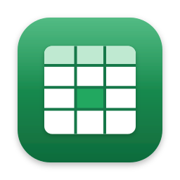
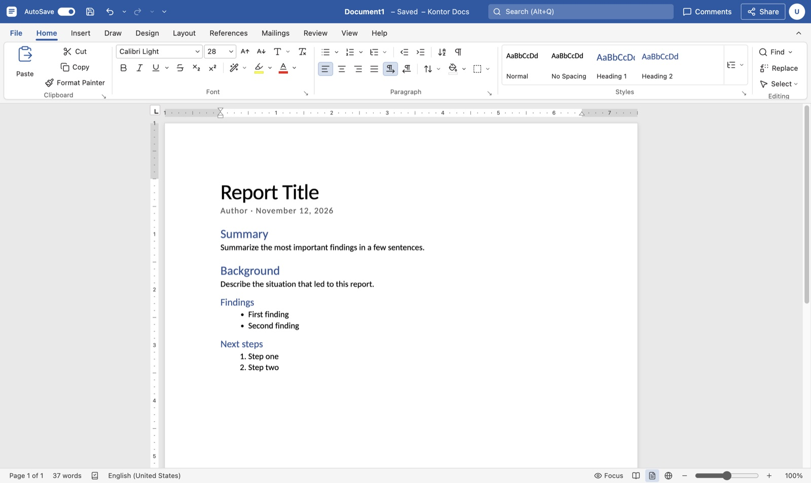
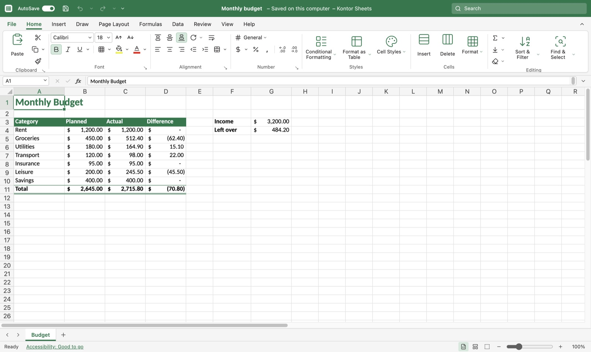
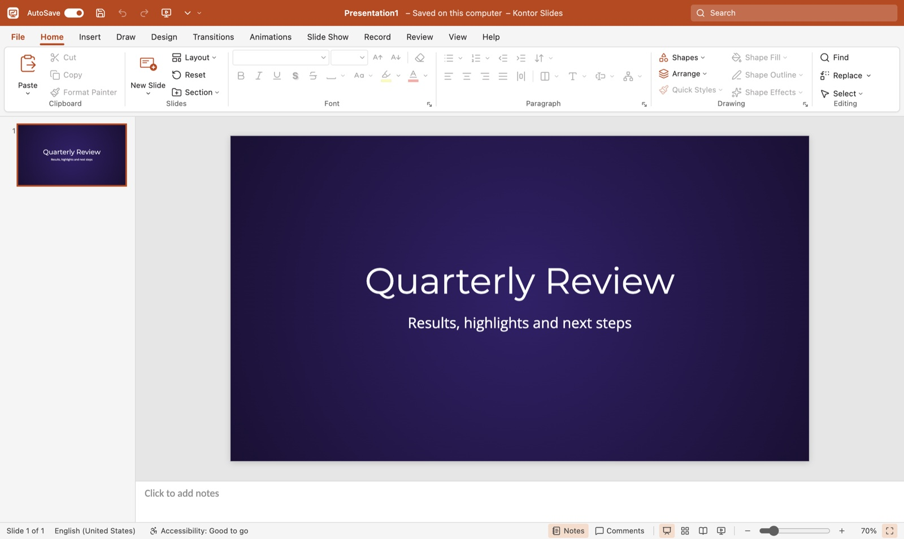

<p align="center">
  
  
  
</p>

<h1 align="center">Kontor</h1>

<p align="center">
  <b>A free, open-source office suite: word processor, spreadsheets and presentations.</b><br />
  Familiar ribbon interface · works offline · opens and saves .docx, .xlsx and .pptx<br />
  Mac · Windows · Linux
</p>

<p align="center">
  <a href="../../releases/latest"><b>Download</b></a> ·
  <a href="#install">Install</a> ·
  <a href="#run-a-program">Run from source</a> ·
  <a href="CONTRIBUTING.md">Contribute</a>
</p>

<p align="center">
  <a href="LICENSE"></a>
  
  
</p>



<table>
  <tr>
    <td></td>
    <td></td>
  </tr>
</table>

## Why Kontor

- **Free for everyone, forever.** MIT license, no account, no subscription, no telemetry.
- **Feels familiar.** Ribbon, menus, dialogs and keyboard shortcuts work the way office users
  already know, so nobody needs training.
- **Your files stay yours.** Everything runs on your computer. Save writes straight into the
  .docx, .xlsx or .pptx file you opened.
- **Complete.** Hundreds of features per program: styles, tables of contents, track changes and
  mail merge; about 500 spreadsheet functions, pivot tables, charts and conditional formatting;
  themes, animations, transitions and presenter view. See the `FEATURES.md` in each folder.
- **Four interface languages:** English, German, French and Spanish, switchable in Options.
- **Ready for companies.** `.msi` and `.pkg` installers for software deployment tools.

## Install

Download the installers from the [latest release](../../releases/latest). Each program has its own:

| System | File |
|---|---|
| Mac with Apple Silicon (M1 or newer) | `Kontor-<Program>-mac-arm64.dmg` |
| Mac with an Intel processor | `Kontor-<Program>-mac-x64.dmg` |
| Windows | `Kontor-<Program>-Setup-windows-x64.exe` |
| Linux | `Kontor-<Program>-linux-x64.AppImage` or `.deb` |
| IT departments | `Kontor-<Program>-windows-x64.msi` (all users) and `Kontor-<Program>-mac-<arch>.pkg` |

You can check which Mac you have under Apple menu › About This Mac.

The apps are not signed with paid certificates yet, so the system asks you to confirm the first
start once:

- **macOS:** open the app, click **Done** in the warning, then open **System Settings › Privacy &
  Security**, scroll down and click **Open Anyway** next to the app's name.
- **Windows** ("Windows protected your PC"): click **More info**, then **Run anyway**.

## The programs

| Folder | Program | What it does | Files | Dev port |
|---|---|---|---|---|
| [`kontor-docs`](kontor-docs) | Kontor Docs | Word processor | `.docx`, `.doc` (open), `.odt`, `.rtf`, `.md`, `.html`, `.txt`, PDF | 5174 |
| [`kontor-sheets`](kontor-sheets) | Kontor Sheets | Spreadsheet | `.xlsx`, `.xls`/`.xlsb` (partly), `.ods`, `.csv`, PDF | 5175 |
| [`kontor-slides`](kontor-slides) | Kontor Slides | Presentations | `.pptx`, `.ppsx`, `.potx`, `.odp`, PDF, PNG/JPEG, video | 5176 |

Each program is self-contained. Its folder has its own `package.json`, dependencies, README and
feature checklist, and nothing is shared between folders. You can copy one folder out and use it
on its own.

## Run a program

Requirements: Node.js 20 or newer.

```bash
cd kontor-sheets
npm install
npm run dev
```

`npm run build` type-checks the program and writes a static production build to `dist/`.
You can host that folder on any static web host, for example on your company's intranet, and use
the program in the browser without installing anything.

## Desktop apps

Each program is also a desktop app (Electron). The `electron/` folder holds the window, the
native open and save dialogs and the AutoSave store; `build/icon.png` is the app icon.

```bash
npm run desktop        # build and start the desktop app
npm run desktop:dist   # build installers into release/ for the current system
```

Installers per release: macOS `.dmg` and `.pkg` (Apple Silicon and Intel), Windows setup `.exe`
and `.msi` (the `.msi` installs for all users, for software deployment tools), Linux
`.AppImage` and `.deb`. The `.pkg` and `.msi` are meant for IT departments.

## Saving

- **Save (Ctrl/Cmd+S)** writes back into the file that was opened or saved last, like any desktop
  program. **Save As** always asks where to save. In browsers without file access (Firefox,
  Safari) Save downloads a copy instead.
- **AutoSave** keeps the open document while you type. The desktop apps store it in files in the
  user data folder; the browser uses localStorage and moves to IndexedDB when that is full.
- Files the system hands over (double-click, Open With) open in the desktop app.

## Publishing a release

1. Raise `version` in the three `package.json` files.
2. Push a tag: `git tag v1.0.0 && git push origin v1.0.0`.
3. The **Release desktop apps** workflow builds the installers on macOS, Windows and Linux and
   attaches them to a GitHub release. The README's download link always points to the latest
   release, so it needs no change.

The repository name lives in each `electron/config.cjs` (`website`) and in each `package.json`
(`homepage`).

## Feature coverage

Every folder has a `FEATURES.md` with a checklist of the original program's features. Each item
is marked as done, partial or open, and the top of the file has the current totals.

| Program | Done | Partial | Open | Weighted (partial counts half) |
|---|---|---|---|---|
| Kontor Docs | 375 | 32 | 7 | 94 % |
| Kontor Sheets (without the function library) | 344 | 23 | 15 | 93 % |
| Kontor Slides | 340 | 38 | 6 | 93.5 % |

The open items need a server, an online service or an AI model (co-authoring, cloud storage,
AI assistants, online pictures) or are not planned (VBA; macros replay the program's own
commands instead).

Every program's interface can be switched between English, German, French and Spanish
(File › Options › Interface language); without a choice it follows the system language.

Files are checked with automated package tests (well-formed XML, content types, relationships,
element order). They have not yet been opened in other office programs as part of testing.

## Tech

React, TypeScript and Vite. The formula engine, the file readers and writers and the page layout
are our own code. The libraries we use are under permissive licenses (MIT, Apache-2.0, BSD, ISC),
and fonts are under the SIL Open Font License.

## Contributing

Bug reports, sample files that open wrongly, translations and pull requests are welcome. See
[CONTRIBUTING.md](CONTRIBUTING.md).

## Name and trademarks

Each program reads its name from `src/brand.ts`. Kontor is not
affiliated with, endorsed by or connected to any maker of other office software. File-format names
such as `.docx`, `.xlsx` and `.pptx` only describe compatibility.
